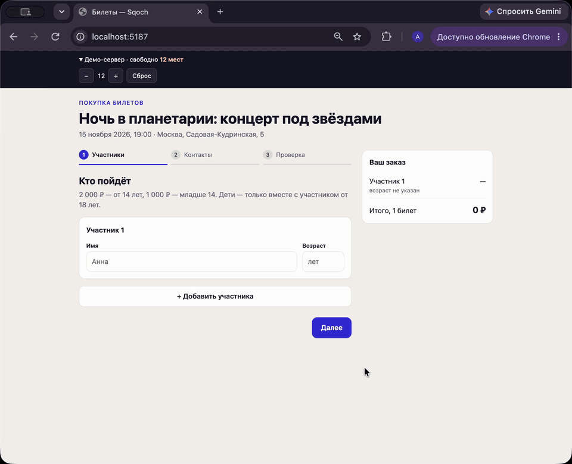

# Оформление билетов — Sqoch, тест 01

React 19 + TypeScript + Vite, без UI-библиотек. Данные моковые, бэкенд эмулируется в памяти.

## Демо



[Запись в полном качестве (mp4)](docs/demo.mp4)

Телефон, 390 px:

<p>
  
  
</p>

## Запуск

```bash
npm install
npm run dev
```

Открыть http://localhost:5173.

## Сценарий

1. **Участники.** 1–4 человека, у каждого имя и возраст. Тип билета и цена видны сразу.
2. **Контакты.** Один email на заказ.
3. **Проверка.** Состав, цены, итог. Любой шаг можно отредактировать, данные сохраняются.
4. **Результат.** Номер заказа или ошибка «места закончились».

**Демо-панель** сверху — это «сервер». Кнопками «−/+» можно уменьшить число свободных мест (вплоть до нуля), пока покупатель на шаге проверки. Клиент узнаёт об этом только при нажатии «Подтвердить», как было бы с реальным API.

## Правила

- до 14 лет — детский билет, 1 000 ₽; от 14 — полный, 2 000 ₽;
- ребёнок до 14 лет — только вместе с участником **от 18** в том же заказе. Участник 14–17 лет платит полную цену, но сопровождающим не считается.

Константы и проверки лежат в `src/domain.ts` (чистые функции без React). «Сервер» перепроверяет заказ теми же функциями и сам считает сумму.

## Структура

```
src/
  domain.ts   правила, валидация, расчёт, форматирование
  api.ts      мок API + пульт для демо-панели
  ui.tsx      поле ввода, сводка заказа, нижняя панель шага
  steps.tsx   шаги: участники, контакты, проверка
  App.tsx     состояние заказа, переключение шагов, экран результата, демо-панель
```

## Время и что не сделано

Затрачено: **25 мин**.

Не сделано, сознательно за рамками часа:
- нет временной брони мест на время оформления — проверка только при подтверждении;
- состояние не переживает перезагрузку страницы;
- нет оплаты и тестов.
